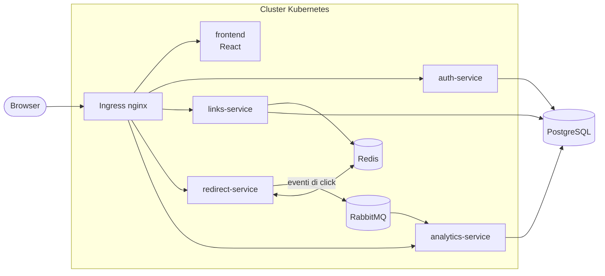

# LinkPulse

**URL shortener con statistiche dei click, realizzato a microservizi su Kubernetes e AWS**

Progetto d'esame di **Sistemi Cloud e Laboratorio**
Corso di Laurea Magistrale in Informatica · Università degli Studi di Catania · A.A. 2026/2027

---

## Il progetto

LinkPulse è un servizio che accorcia gli indirizzi web e tiene traccia di quante volte, e da dove, vengono aperti.
Un utente registrato può:

- creare link brevi, anche con un nome scelto da lui e una data di scadenza;
- condividerli: chi apre il link viene reindirizzato all'indirizzo originale;
- consultare per ogni link il numero di click nel tempo, i dispositivi, i browser e la provenienza.

L'obiettivo, in linea con il programma del corso, è realizzare l'applicazione come insieme di **microservizi in container**, distribuirla prima su un **cluster Kubernetes locale** e poi su **AWS con servizi gestiti**, automatizzando infrastruttura e rilasci.

## Architettura

Applicazione **3-tier** a microservizi, con comunicazione asincrona per la registrazione dei click.

| Componente | Ruolo |
|---|---|
| `frontend` | Interfaccia web: login, gestione dei link, dashboard con i grafici |
| `auth-service` | Registrazione e login degli utenti, rilascio del token JWT |
| `links-service` | Creazione, modifica ed eliminazione dei link |
| `redirect-service` | Risolve il link breve, reindirizza all'indirizzo originale e segnala il click |
| `analytics-service` | Elabora i click ricevuti dalla coda e calcola le statistiche |
| PostgreSQL | Database principale: utenti, link e click, con uno schema per servizio |
| Redis | Cache degli indirizzi più richiesti, per non interrogare il database a ogni click |
| RabbitMQ | Coda degli eventi di click tra `redirect-service` e `analytics-service` |

Il redirect non attende il salvataggio del click: l'evento resta in coda finché `analytics-service` non lo elabora, così la latenza percepita dall'utente resta bassa anche sotto carico.

## Dal cluster locale ad AWS

| | Versione locale | Versione AWS |
|---|---|---|
| Orchestrazione | Kubernetes (kubeadm) su VM Multipass | Amazon EKS |
| Database | PostgreSQL nel cluster | Amazon RDS for PostgreSQL |
| Cache | Redis nel cluster | Amazon ElastiCache for Redis |
| Coda di messaggi | RabbitMQ nel cluster | Amazon MQ for RabbitMQ |
| Registry delle immagini | GitHub Container Registry | Amazon ECR |
| Monitoraggio | — | Amazon CloudWatch + SNS |
| Infrastructure as Code | Terraform + Ansible | Terraform + Ansible |
| CI/CD | GitHub Actions | GitHub Actions |

## Argomenti del corso affrontati

- **Containerizzazione** dei servizi con Docker
- **Orchestrazione** con Kubernetes: deployment, service, ingress, scalabilità orizzontale
- **Cluster reale in locale** con macchine virtuali Multipass
- **Infrastructure as Code** con Terraform (provisioning) e Ansible (configurazione)
- **Migrazione su cloud pubblico** con servizi gestiti AWS
- **Alta disponibilità** su più Availability Zone e Auto Scaling
- **Comunicazione asincrona** tra microservizi tramite code di messaggi
- **Monitoraggio e notifiche** con CloudWatch e SNS
- **CI/CD** con GitHub Actions

## Stato del progetto

| Attività | Stato |
|---|---|
| Progettazione e presentazione del progetto | ✅ Completata |
| Microservizi e frontend | 🔄 In corso |
| Deployment su Kubernetes locale | ⏳ Da fare |
| Deployment su AWS | ⏳ Da fare |
| Pipeline CI/CD | ⏳ Da fare |

Il repository viene aggiornato man mano che il lavoro procede.

## Documentazione

- 📄 [Presentazione del progetto (PDF)](docs/presentazione/LinkPulse-Presentazione.pdf)

## Autore

**Giuseppe Russo** · Università degli Studi di Catania
